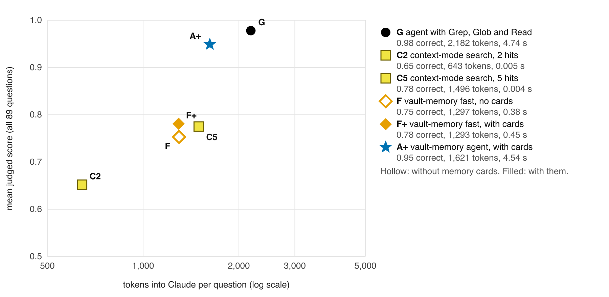
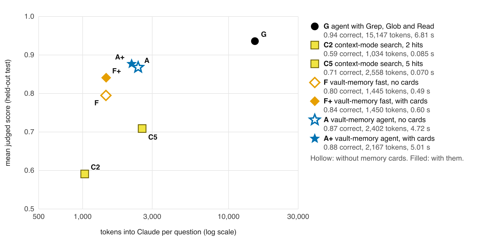

# vault-memory

**Memory for Claude over an Obsidian vault.** Every note is encoded once, at write time, into chunks, embeddings, a
full-text index, the wikilink graph and a short card of dated facts. A question then gets back one small block of
memory, about 1,500 tokens, instead of a grep session. The block holds the right passages from the right notes, an
exact-facts section for the dates, numbers, paths and ids a model must not paraphrase, and the path of every note it used.

```
$ vault-memory recall "how do I add a comment to a page?"
Memory for: how do I add a comment to a page?
[1] Guide/Comments, Mentions and Replies.md (Add a comment)
  - The /comment slash command on a new line also inserts a comment.
  Add a comment: SilverBullet leverage's HTML-style [[Markdown/Comment]] syntax to add comments: ...
```

## Why it's interesting

Claude Code sessions remember things today by preloading an index file (`MEMORY.md`) and grepping for the rest. On a
3,600-note vault that works well, and it is expensive: the index alone is about 10,000 tokens, and every lookup is a
multi-turn search. Retrieval tools fix the cost and lose the accuracy. This repo asks whether a memory layer built the
way recent memory research suggests (encode once, hand the model a fixed small block, use the structure notes already
have) can keep grep's accuracy at a fraction of its context. And it measures the answer on questions that are checked
against the notes, with a fixed reader and judge, on a corpus anyone can download.

The short answer: one recall call beats keyword search on accuracy at a similar block size. As an agent, it comes
within a few questions of grep: on a real 3,600-note vault with about a seventh of grep's context, and on the public
docs with 26% fewer tokens. It does not beat grep yet. Where grep still wins is current state: an older note says one
thing, a newer note says it changed, and an agent that reads the index first sees the change.

## Results on a public corpus

The [SilverBullet](https://github.com/silverbulletmd/silverbullet) documentation (MIT, 301 notes, 2,226 wikilinks,
pinned at `01d6b0e`), with 89 questions written from the notes to the same spec as the private set below. Nothing was
tuned on this corpus, so every question is unseen.



| SilverBullet docs, 89 questions | mean judged | correct / partial / wrong | one note | two notes | verbatim | tokens into Claude | seconds |
|---|---|---|---|---|---|---|---|
| agent with Grep, Glob and Read | **0.978** | 85 / 4 / 0 | 0.967 | 0.966 | 1.0 | 2,182 | 4.7 |
| context-mode search, 5 hits | 0.775 | 64 / 10 / 15 | 0.783 | 0.569 | 0.967 | 1,496 | 0.004 |
| context-mode search, 2 hits | 0.652 | 54 / 8 / 27 | 0.683 | 0.466 | 0.8 | 643 | 0.005 |
| embedding top-5 | 0.663 | 53 / 12 / 24 | 0.683 | 0.569 | 0.733 | 1,058 | 0.004 |
| vault-memory fast, no cards | 0.753 | 61 / 12 / 16 | 0.733 | 0.655 | 0.867 | 1,297 | 0.38 |
| **vault-memory fast, with cards** | 0.781 | 63 / 13 / 13 | 0.783 | 0.655 | 0.9 | 1,293 | 0.45 |
| **vault-memory agent, with cards** | 0.949 | 81 / 7 / 1 | 0.917 | 0.931 | 1.0 | 1,621 | 4.5 |

Given a tool and a few turns, both agents find nearly everything here. The recall agent scores 0.949 against grep's
0.978, four fewer answers fully correct (81 against 85), with 26% fewer tokens in context (1,621 against 2,182) in
about the same time. Single-shot, fast recall with cards ties context-mode at 5 hits (0.781 against 0.775) with 14%
fewer tokens, and wins on two-note questions (0.655 against 0.569). Keyword search is strong on a small docs corpus
whose page titles match how people ask. On the seeded held-out 30, fast recall with cards scores 0.817 against 0.750,
and the two agents 0.933 and 0.950.

Rerun it from a fresh clone (Python 3.12, [uv](https://docs.astral.sh/uv/), and the `claude` CLI for the cards):

```sh
git clone https://github.com/abhaymettu/obsidian-vault-memory && cd obsidian-vault-memory
sh bench/public.sh            # fetch the docs, index, cards (~$0.40 of Haiku), free retrieval score, cached table
sh bench/public.sh --judged   # also rerun the single-shot arms with a Sonnet reader and judge (~$2)
```

## Results on a private vault

The same harness on a real working vault: 3,614 notes, 323 questions, of which a seeded third per type (110) is held
out from every tuning decision. The questions quote the owner's notes, so they stay private; the code that wrote and
checked them ships (`bench/QUESTION-SPEC.md`, `bench/check_questions.py`).



| Held-out test, 110 questions | mean judged | correct / partial / wrong | one note | two notes | verbatim | tokens into Claude | seconds |
|---|---|---|---|---|---|---|---|
| agent with the `MEMORY.md` index, Grep, Glob and Read | **0.936** | 99 / 8 / 3 | 0.946 | 0.889 | 0.973 | 15,147 | 6.8 |
| context-mode search, 5 hits | 0.709 | 72 / 12 / 26 | 0.662 | 0.569 | 0.892 | 2,558 | 0.07 |
| context-mode search, 2 hits | 0.591 | 58 / 14 / 38 | 0.581 | 0.375 | 0.811 | 1,034 | 0.09 |
| embedding top-5 | 0.659 | 63 / 19 / 28 | 0.703 | 0.514 | 0.757 | 1,860 | 0.01 |
| vault-memory fast, no cards | 0.795 | 82 / 11 / 17 | 0.892 | 0.514 | 0.973 | 1,445 | 0.50 |
| **vault-memory fast, with cards** | 0.841 | 84 / 17 / 9 | 0.932 | 0.583 | 1.0 | 1,450 | 0.61 |
| vault-memory agent, no cards | 0.868 | 92 / 7 / 11 | 0.851 | 0.778 | 0.973 | 2,402 | 4.7 |
| **vault-memory agent, with cards** | 0.877 | 94 / 5 / 11 | 0.892 | 0.764 | 0.973 | 2,167 | 5.0 |
| vault-memory fast, with cards and recency | 0.845 | 84 / 18 / 8 | 0.919 | 0.611 | 1.0 | 1,450 | 0.61 |
| vault-memory agent, with cards and recency | 0.900 | 95 / 8 / 7 | 0.905 | 0.819 | 0.973 | 1,995 | 5.0 |

- **Cards help the fast mode most.** Fast recall goes from 0.795 to 0.841 at the same block size, wrong answers drop
  from 17 to 9, and every verbatim answer is exact.
- **Against search, it wins on accuracy at a similar size, not on speed.** 0.841 against 0.709 for context-mode at 5
  hits, with 43% fewer tokens, in 0.61 s against 0.07 s.
- **Against grep, it trades accuracy for context.** The recall agent scores 0.877 to 0.900 against 0.936, with about a
  seventh of the context (the grep figure includes the 10,221-token index it preloads). Paired, grep is better on 9
  questions and the recall agent on 5. Most of grep's wins are superseded facts.
- **Recency ordering did not move it.** Ranking newer notes higher, and putting the newer of two linked notes first,
  changed nothing beyond run-to-run variation: on dev, a retrieval score of 0.9126 against 0.9095 (the bar was 0.005);
  held out, 3 questions up and 3 down for fast recall and 9 up and 5 down for the agent. Telling the reader that the
  newer of two notes is current made it worse (0.810 against 0.822 and 0.829 on dev), because in a working vault a
  newer linked note usually adds to an older one instead of replacing it. What the reader needs is a labelled change,
  and that is the next thing to build: see [Limits](#limits).

## Use it on your vault

```sh
export VAULT_MEMORY_VAULT=~/Notes      # or vault = "~/Notes" in ~/.config/vault-memory/config.toml; only ever read
uv run vault-memory index && uv run vault-memory cards    # encode; cards need the claude CLI, Haiku, a few notes a call
uv run vault-memory serve & uv run vault-memory recall "what did we decide about the deploy key?"
```

`recall` refreshes the index on every call (a stat pass, about 0.08 s on 3,600 notes), so a note saved a minute ago is
already in it; its card arrives on the next `vault-memory cards`. `--budget 4000` gives a bigger block, `--mode synth`
condenses a 3,000-token slice with one Sonnet call, and `vault-memory mcp` serves the same `recall` as a one-tool MCP
server. The first index of 3,600 notes took 27 minutes on an M4 Pro (CPU embeddings); the first cards cost $9.21
API-equivalent. A skill for Claude Code that tells sessions when to recall is in [skill/SKILL.md](skill/SKILL.md).

## How it works

```
write time (once per changed note)          recall time (reads only the store)
  note -> chunks (~140 words, by heading)     question -> dense top-100 + BM25 top-100, fused (RRF)
       -> bge-small embeddings (float16)               -> + best chunk of linked notes (wikilinks, both ways)
       -> SQLite FTS5 (porter)                         -> + best chunk of the 10 closest whole notes
       -> resolved wikilink graph                      -> + top 20 card facts (dense + BM25 over facts, fused)
       -> memory card (one small-model call):          -> cross-encoder rerank (MiniLM, 600-char passages)
          dated facts, entities, links                 -> pack under the budget: 2 passages, 4 facts per note
                                                       -> exact-facts lines (dates, numbers, paths, ids)
```

The design borrows three principles from [Memorilla](https://memory.stanford.edu/) (arXiv 2610.21375): encode at write
time and never re-read the raw store at query time, give the model a fixed small block instead of a pile of chunks, and
keep recall cost flat as the store grows. Memorilla writes learned memory tokens into an open model's input embeddings.
Claude's are closed, so here every principle becomes text. Cards follow Mem0 and A-MEM: extract each note's facts once,
search the facts beside the chunks. Like the summary tree in Victor Taelin's [OptMem](https://github.com/VictorTaelin/OptMem),
cards are a cache rebuilt from the notes alone: a card is keyed by its note's content hash, so an edited note's old card
stops being used at once and only edited notes are sent again.

Two choices did most of the work in a 10-round hill-climb on the dev split: two passages per note in the block, and
note-level retrieval (each note's mean chunk vector), which pulls in the second note of a two-note question. What did
not help: splitting questions into clauses, trimming passages to matching sentences, blending first-stage rank into
the reranker, a bigger rerank pool, pseudo-relevance feedback, two other rerankers, and recency ordering.

## How the benchmark works

- **Questions.** Three types, a third each: the answer is in one note, needs two notes combined, or is an exact string
  (a date, a number, a path, an id). Each question carries the verbatim evidence it was written from, and
  `bench/check_questions.py` rejects any quote not found in its note. A seeded third of each type is held out.
- **Scoring.** A fixed reader (Sonnet) answers from what each system returns, and a Sonnet judge grades it against the
  gold answer: CORRECT 1, PARTIAL 0.5, WRONG 0. A verbatim answer scores 1 only if it contains an accepted exact
  string, so "49 of the 92 lanes" fails a gold of "49 of 92 lanes". The scores are means of those grades, not the
  share fully correct, and the counts sit beside every mean. Two runs of the same code differ by about 0.007 (11 of
  213 questions flipped on dev), so differences that small are noise.
- **Tokens into Claude** is Claude's own input count minus a calibrated template overhead: the question plus the block
  for single-shot systems, the final turn's context for agents.
- **Seconds** are warm retrieval time for single-shot systems and the whole session for agents.
- **Baselines.** context-mode's own `ContentStore` and snippet code (version 1.0.169, imported from your install at run
  time, nothing copied), plain embedding top-5 over the same chunks, and a Claude Code agent with Grep, Glob and Read
  (plus the memory index when one is configured).
- **Cost.** Every model call goes through `claude -p` and is logged to a ledger with its API-equivalent cost;
  `VAULT_MEMORY_SPEND_CAP` stops a run past a cap.
- **Free proxy.** `bench.proxy` scores whether the gold evidence reaches the block, deterministically and with no model
  calls; the hill-climbs ran on it. It cannot see what the reader does with a block, which is why recency was also
  judged.

## Limits

- **Superseded facts.** Recall ranks by relevance, not by which note is current, and showing dates or a
  newer-is-current hint did not help. The next step is a labelled change: a card fact that says what replaced what,
  kept only when the newer note's own words back it (an exact span, checked like the card facts are), shown in the block
  as superseded. Without that span, nothing older is hidden.
- **Speed.** Fast recall takes about 0.6 s warm against under 0.1 s for keyword search, and needs `vault-memory serve`;
  a cold call loads the models first.
- **One judge, one reader, one split.** Every number uses Sonnet as reader and judge on one held-out split.
- **The public corpus is small and well titled**, which favours keyword search; the private vault is one person's.
- **Cards cost money once.** $9.21 API-equivalent for 3,437 notes with Haiku, $0.39 for the 301 public ones.

## Credits and licences

MIT, see [LICENSE](LICENSE). Models downloaded at run time through fastembed:
[BAAI/bge-small-en-v1.5](https://huggingface.co/BAAI/bge-small-en-v1.5) (MIT, as the ONNX build
Qdrant/bge-small-en-v1.5-onnx-Q) and [cross-encoder/ms-marco-MiniLM-L-6-v2](https://huggingface.co/cross-encoder/ms-marco-MiniLM-L-6-v2)
(Apache-2.0, as Xenova's ONNX build; trained on MS MARCO, whose data terms are for non-commercial research). The
public questions quote the SilverBullet docs, Copyright 2022 Zef Hemel, MIT ([bench/data/public/CORPUS-LICENSE.md](bench/data/public/CORPUS-LICENSE.md)).
The context-mode baseline runs your own install of [context-mode](https://github.com/mksglu/context-mode) (Elastic
License 2.0); none of its code is in this repo.

Setup, layout and checks for agents: [AGENTS.md](AGENTS.md).
